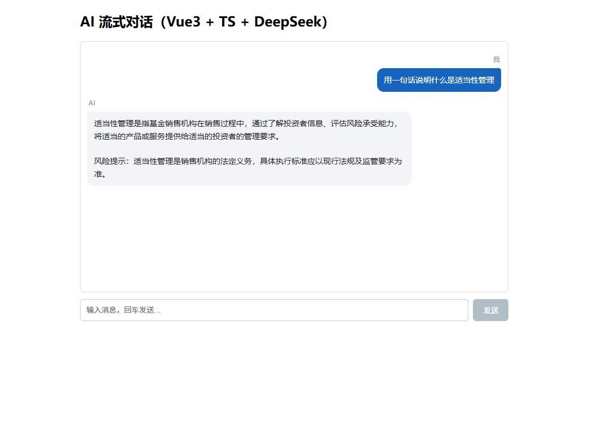

# AI Chat · SSE 流式对话（DeepSeek + Vue3 + Express）

一个从零手写的 AI 应用层最小可运行项目：前端 Vue3 + TypeScript，后端 Express 代理 DeepSeek，
用 SSE 把回答逐字流式吐回浏览器。定位为「AI 大模型应用开发」学习作品 1，业务场景取自基金销售合规问答。

## 为什么做这个

目标是跑通一次 LLM 调用的完整链路，并把工程上真正会踩的坑逐一解决：
密钥不能进前端、中文流式不能乱码/丢字、system prompt 不能串味、用户要能中途停止。
项目不含任何真实客户数据，`data/kb/` 下是虚构脱敏的教学样例文档。

## 技术栈

| 层 | 选型 |
|---|---|
| 前端 | Vue 3 + TypeScript + Vite，`fetch` + `ReadableStream` 读 SSE |
| 后端 | Node.js + Express + tsx，`dotenv` 读密钥，转发 DeepSeek 流式响应 |
| 模型 | DeepSeek（OpenAI 兼容接口，`base_url=https://api.deepseek.com`） |
| 通信 | SSE（`text/event-stream`），Vite `/api` 代理到 `http://localhost:3001` |

## 快速开始

```bash
npm install
copy .env.example .env        # Windows cmd；macOS/Linux 用 cp
# 编辑 .env，填入 DEEPSEEK_API_KEY
npm run dev:all               # 同时起后端 3001 与前端 5173
```

浏览器打开 <http://localhost:5173>。`npm run build` 可单独构建前端。

`.env` 说明：

```dotenv
DEEPSEEK_API_KEY=sk-...
DEEPSEEK_MODEL=deepseek-flash   # 官方改名时只改这一行，不用翻代码
```

`.env` 已被 `.gitignore` 忽略，**不要提交**。

## 目录结构

```
src/
  App.vue                    # 组装层：布局、自动滚动、错误横幅、输入区
  components/Message.vue     # 纯展示：role / content / pending 三个 props
  composables/useChat.ts     # 状态与网络：messages/input/busy/err + send()/abort()
server/index.ts              # SSE 代理、system prompt 组装、错误帧回传
data/prompts.md              # Prompt 模板库（按 ## 段落隔离）
data/prompt-config.json      # variant / temperature / disableThinking / jsonMode
data/kb/                     # 虚构脱敏的基金合规文档（供后续 RAG 使用）
```

## 关键实现

1. **SSE 行缓冲**：`TextDecoder({ stream: true })` 逐块解码，按 `\n` 拆行并把最后半行留到下一包，
   处理 `data:` / `[DONE]` / 后端 `error` 帧。中文一个字可能跨两个网络包，这段逻辑必须保留。
   已用 7 字节人为分片验证：16577 字节切成 2369 个小包后仍能拼出 98 个中文字符，无 U+FFFD。
2. **密钥只在服务端**：前端只请求 `/api/chat`，key 由后端从 `.env` 注入，前端永不接触。
3. **Prompt 段落隔离**：模板库按 `##` 切段，`variant` 决定本轮 system 放哪一段（含 `none` 完全不放），
   配置每次请求重读、改配置不用重启。解决了「三条模板塞进同一段 system 导致串味」的问题。
4. **可中断的流**：`AbortController` 让用户点「停止」，保留已生成文字；组件卸载自动断流，
   不把 `AbortError` 显示成请求失败。
5. **自动滚动**：监听 `messages.at(-1)?.content` 而不是数组长度 —— 流式过程中条数不变，
   变的是最后一条的内容。

## 已验证

- `npm run build` 通过；
- 真实接口 `HTTP 200 / text/event-stream`，中文逐字输出无乱码；
- 5 组 Prompt A/B 回归（角色有无、少样本、结构化输出、温度 0 与 0.7、越界拒答），
  结论压缩在 `每日工作台.md` 的 `⑤ 复习速查`（原始 A/B 表已备份）；
- 浏览器实测 5 项：中文逐字 / 连发两条不覆盖 / 自动滚到底 / 断网报错可重发 / 停止保留已生成文字。

## 截图



## 后续路线

RAG 知识库（切分 / 向量化 / 召回 / 引用）、检索层权限过滤、评测集、Docker 容器化、
Dify 私有化部署与金融合规场景 POC。

## 说明

`data/kb/` 内文档均为虚构教学样例，不含真实客户信息；`notes/` 是学习过程记录，随项目一起留存。